<!--
  VisionFit README — every visual below is a hand-built, animated SVG in /docs/readme,
  generated by docs/readme/build.py. Edit the content there, run `python docs/readme/build.py`, commit.
-->

<a href="#getting-started">
  
</a>

<p align="center">
  
  
  
  
  
  
  
</p>

<p align="center">
  <a href="#architecture"><b>Kiến trúc</b></a> &nbsp;·&nbsp;
  <a href="#modules"><b>Phân hệ</b></a> &nbsp;·&nbsp;
  <a href="#training"><b>Huấn luyện AI</b></a> &nbsp;·&nbsp;
  <a href="#getting-started"><b>Cài đặt</b></a> &nbsp;·&nbsp;
  <a href="#structure"><b>Cấu trúc</b></a>
</p>

<br />

<picture>
  <source media="(prefers-color-scheme: light)" srcset="docs/readme/chapter-about-light.svg" />
  
</picture>


> **VisionFit** ứng dụng **thị giác máy tính** và **AI** để phân tích kỹ thuật tập gym chỉ với **một camera**, không cần cảm biến đeo người. Đi kèm là một nền tảng quản lý phòng gym đa nền tảng, kết nối **Hội viên**, **Huấn luyện viên cá nhân (PT)** và **Ban quản lý**.

<br />

<picture>
  <source media="(prefers-color-scheme: light)" srcset="docs/readme/chapter-numbers-light.svg" />
  
</picture>


<br /><br />

<a id="architecture"></a>

<picture>
  <source media="(prefers-color-scheme: light)" srcset="docs/readme/chapter-architecture-light.svg" />
  
</picture>



<br /><br />

<a id="modules"></a>

<picture>
  <source media="(prefers-color-scheme: light)" srcset="docs/readme/chapter-modules-light.svg" />
  
</picture>

<a href="modules/model_AI/visionfit-ai-pro"></a>

<a href="modules/backend/visionfit/app/Services/Assistant"></a>

<a href="modules/backend/visionfit"></a>

<a href="modules/appmobile/VF"></a>

<a href="modules/web-app/web-visionfit"></a>

<details>
<summary><b>🔍 Xem chi tiết kỹ thuật từng phân hệ</b></summary>

<br />

#### 🎯 Lõi thị giác máy tính: `modules/model_AI/visionfit-ai-pro`
- **PoseNet**: nhận ảnh RGB `128×128`, hồi quy heatmap ra 33 điểm khớp `(x, y)` kèm visibility/confidence, theo chuẩn 33 landmark của MediaPipe Pose. Tọa độ được chuẩn hóa về tâm hông (*hip-centering*) và theo tỉ lệ thân người (*torso-scaling*), nên kết quả không phụ thuộc khoảng cách hay góc máy.
- **ActionNet**: Temporal CNN nhận chuỗi 32 khung × 33 khớp × 4 giá trị, phân loại theo [`labels.json`](modules/model_AI/visionfit-ai-pro/labels.json): `squat` · `push_up` · `lunge` · `standing`.
- **Biomechanics & bộ đếm rep**: tính góc gối, khuỷu tay và gập hông theo thời gian thực. Máy trạng thái hữu hạn (FSM) lọc nhiễu tín hiệu và bắt các điểm đỉnh/đáy, chỉ ghi nhận một rep khi động tác hoàn thành đúng kỹ thuật.
- **Web Studio** (`web_server.py`): giao diện HTML5 Canvas để soi skeleton từ webcam hoặc video. Kèm các công cụ `pose_annotator.py`, `extract_clips.py` và `metrics.py`.

#### 🤖 Trợ lý VIF: `backend/visionfit/app/Services/Assistant` + `modules/model_AI/Chatbox_AI`
- **Orchestrator trong Laravel**: dùng Gemini **Native Function Calling** với 9 tool nội bộ: `get_my_schedule`, `get_my_packages`, `get_my_progress`, `get_my_body_metrics`, `get_my_meal_plan`, `get_gym_summary`, `search_fitness_knowledge`, `set_water_reminder`, `suggest_app_navigation`.
- **Tri thức ngữ nghĩa**: dùng `gemini-embedding-001`, chỉ cache vector của câu truy vấn, không cache kết quả theo từng người dùng.
- **Bền bỉ**: có model dự phòng và client OpenAI-compatible. Xử lý riêng các trường hợp timeout, 429, 5xx và vượt quota theo phút.
- **Chatbox_AI** (Node.js 24, ES Modules): bản trợ lý chạy độc lập. Lấy ngữ cảnh qua `/assistant/me` và `/assistant/context`, lưu phiên bằng cookie HTTP-only, lịch sử SQLite tách riêng theo `gym_id + role + user_id`.

#### ⚙️ Backend: `modules/backend/visionfit`
- Laravel 12 · PHP 8.2 · **Sanctum** (token đa vai trò: Client, Trainer, Admin) · **Reverb** (chat Hội viên ↔ PT, thông báo realtime).
- Quản lý hội viên, PT, gói tập, buổi tập, lịch tập, thanh toán và hóa đơn. Có mạng xã hội gym (đăng bài, bình luận, thả tim) và bách khoa dinh dưỡng.

#### 📱 Mobile: `modules/appmobile/VF`
- React Native 0.87 · React 19 · TypeScript.
- **Hội viên**: khảo sát thể trạng, đặt mục tiêu, giáo án cá nhân, streak, calo; gửi video để AI phân tích; chat với PT và VIF; mua gói tập, quét QR điểm danh.
- **PT**: danh sách học viên, lịch dạy, chấm điểm buổi tập, doanh thu cá nhân.

#### 💻 Web Admin: `modules/web-app/web-visionfit`
- Vue 3 (Composition API) · Vite · Bootstrap 5 · Chart.js.
- Dashboard doanh thu, hội viên mới và tỷ lệ gia hạn; quản lý gói tập, giao dịch, PT và lớp học; báo cáo chất lượng phân tích AI; phân quyền Admin / Manager / Staff.

</details>

<br />

<a id="training"></a>

<picture>
  <source media="(prefers-color-scheme: light)" srcset="docs/readme/chapter-pipeline-light.svg" />
  
</picture>



<details>
<summary><b>⌨️ Lệnh cho từng bước</b> (chạy trong <code>modules/model_AI/visionfit-ai-pro</code>)</summary>

```bash
# 01 — Trích khung hình từ video quay thật
python extract_frames.py --video videos/squat_01.mp4 --out data/frames/person01 --every 10

# 02 — Gán nhãn 33 điểm khớp bằng công cụ đồ họa
python pose_annotator.py --images data/frames/person01 --subject person01 --out data/pose_real.npz

# 03 — Huấn luyện PoseNet
python pose_model.py train --data data/pose_real.npz --out models/pose.pt --epochs 50 --batch 8

# 04 — Cắt clip động tác thành chuỗi khung
python extract_clips.py --source videos/squat_01.mp4 --pose-model models/pose.pt --label squat --subject person01

# 05 — Huấn luyện ActionNet
python visionfit.py train --data data/gym_actions.npz --labels labels.json --out models/action.pt --epochs 40

# Kiểm thử nhanh với dữ liệu mẫu
python visionfit.py predict --model models/action_demo.pt --input data/example.npy
```

</details>

<br />

<picture>
  <source media="(prefers-color-scheme: light)" srcset="docs/readme/chapter-stack-light.svg" />
  
</picture>


<br /><br />

<a id="getting-started"></a>

<picture>
  <source media="(prefers-color-scheme: light)" srcset="docs/readme/chapter-start-light.svg" />
  
</picture>

**Yêu cầu:** Python `3.10+` · Node.js `24+` · PHP `8.2+` + Composer · MySQL · Android Studio hoặc Xcode (cho app di động).

```bash
git clone https://github.com/xuantruong5/VisionFit.git
cd VisionFit
```

<details open>
<summary><b>⚙️ 1. Backend Laravel</b> · <code>:8000</code></summary>

```bash
cd modules/backend/visionfit
composer install && npm install
cp .env.example .env            # Windows: copy .env.example .env
php artisan key:generate
# Sửa DB_* trong .env sang MySQL, thêm GEMINI_API_KEY để bật trợ lý VIF
php artisan migrate
php artisan serve --host=0.0.0.0 --port=8000   # chỉ 1 request mỗi lúc, dùng khi dev một mình
```

> [!NOTE]
> Trợ lý VIF **tự lập chỉ mục kho kiến thức** ở lần hỏi đầu tiên, không cần chạy thêm lệnh nào.
> Demo hoặc nhiều người dùng cùng lúc thì chạy bằng **XAMPP Apache** (150 request song song) hoặc **Nginx + PHP-FPM**, xem [`deploy/README.md`](modules/backend/visionfit/deploy/README.md).

</details>

<details>
<summary><b>🎯 2. Lõi AI & Web Studio</b> · <code>:8080</code></summary>

```bash
cd modules/model_AI/visionfit-ai-pro
python -m venv .venv
.venv\Scripts\activate          # macOS/Linux: source .venv/bin/activate
pip install -r requirements-camera.txt
python web_server.py            # hoặc chạy run_web.bat trên Windows
```

</details>

<details>
<summary><b>🤖 3. Trợ lý VIF độc lập (Chatbox_AI)</b> · <code>:3000</code></summary>

```bash
cd modules/model_AI/Chatbox_AI
npm install
cp .env.example .env
npm run dev                     # npm test để chạy bộ kiểm thử
```

</details>

<details>
<summary><b>💻 4. Web Admin</b> · <code>:5173</code></summary>

```bash
cd modules/web-app/web-visionfit
npm install
npm run dev
```

</details>

<details>
<summary><b>📱 5. App di động React Native</b></summary>

```bash
cd modules/appmobile/VF
npm install
npm run start                   # Metro bundler
npm run android                 # terminal khác · hoặc: npm run ios
```

> [!TIP]
> Địa chỉ backend được cấu hình trong [`apiConfig.ts`](modules/appmobile/VF/src/general/apiConfig.ts) qua biến môi trường, **không ghi cứng IP** trong code:
> `VISIONFIT_API_BASE_URL` (ưu tiên cao nhất), hoặc `VISIONFIT_API_HOST` + `VISIONFIT_API_PORT` (mặc định `8000`).
> Android Emulator tự dùng `10.0.2.2`. Thiết bị thật thì cần đặt IP LAN của máy chạy backend.

</details>

<br />

<a id="structure"></a>

<details>
<summary><b>📁 Cấu trúc thư mục</b></summary>

```text
VisionFit/
├── modules/
│   ├── model_AI/
│   │   ├── visionfit-ai-pro/        # 🎯 PyTorch PoseNet, ActionNet, Web Studio
│   │   │   ├── data/  models/  web/
│   │   │   ├── pose_model.py        # PoseNet 33 khớp
│   │   │   ├── visionfit.py         # ActionNet train / predict
│   │   │   ├── repetition.py        # Đếm rep squat · push-up · lunge
│   │   │   └── web_server.py        # Máy chủ Web Studio cục bộ
│   │   └── Chatbox_AI/              # 🤖 Trợ lý VIF độc lập (Node.js 24)
│   ├── backend/visionfit/           # ⚙️ Laravel 12 API
│   │   ├── app/Http/Controllers/
│   │   ├── app/Services/Assistant/  # Gemini Function Calling + embedding
│   │   ├── database/  routes/
│   ├── appmobile/VF/                # 📱 React Native (member / trainer / chat)
│   └── web-app/web-visionfit/       # 💻 Vue 3 + Vite Admin
├── docs/readme/                     # 🎨 SVG của README + build.py
├── LICENSE
└── README.md
```

</details>

<br />

<p align="center">
  <a href="https://github.com/xuantruong5/VisionFit/graphs/contributors">
    
  </a>
  <br />
  <sub>Dự án Nghiên cứu Khoa học · phát hành theo giấy phép <a href="LICENSE"><b>MIT</b></a>.</sub>
</p>

<br />

<picture>
  <source media="(prefers-color-scheme: light)" srcset="docs/readme/footer-light.svg" />
  
</picture>
