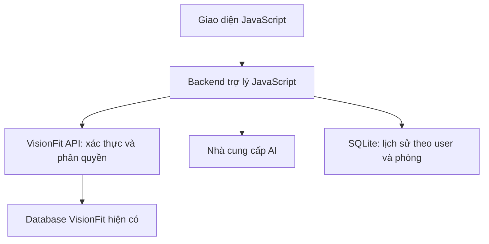

# VIF · VisionFit Assistant

**Trợ lý tập luyện tiếng Việt, phát triển độc lập và kết nối VisionFit qua API.**

Giao diện xanh rêu / xanh lime, linh vật VIF bằng CSS, khung chat responsive, đăng nhập theo vai trò và lịch sử riêng từng tài khoản. **Giao diện và server đều dùng JavaScript**, không cần PHP, Python, TypeScript hoặc tải toàn bộ VisionFit để chạy bản demo.

> **Trạng thái:** có bản demo và bộ tích hợp Laravel đọc database VisionFit qua API. Chưa kết nối server VisionFit thật và chưa kiểm thử với nhà cung cấp AI thật. Chế độ demo trả lời theo kịch bản, không phải mô hình AI. Không có dữ liệu khách hàng hoặc khóa bí mật trong repo.

## Chạy nhanh

Cài **Node.js 24 trở lên**, sau đó:

```bash
git clone https://github.com/HungNguyen3205/Chatbox_AI.git
cd Chatbox_AI
npm install
npm run dev
```

Mở **http://localhost:3000**. Những lần sau chỉ cần `npm run dev`: một tiến trình chạy cả giao diện và backend. Dự án dùng thư viện có sẵn của Node.js, không có dependency bên ngoài.

| Vai trò demo | Email | Mật khẩu |
|---|---|---|
| Hội viên | member@demo.visionfit.local | Demo123! |
| PT | trainer@demo.visionfit.local | Demo123! |
| Quản lý | admin@demo.visionfit.local | Demo123! |

Form tự điền khi đổi vai trò. Tài khoản demo **không phải** tài khoản VisionFit. Thử: “Gói tập của tôi còn bao nhiêu buổi?”, “Lịch tập tiếp theo của tôi là gì?”, “Tiến độ tuần này thế nào?”.

## Có gì trong bản gốc?

- Đăng nhập, đăng xuất; phiên server bằng cookie HttpOnly/SameSite Strict; token VisionFit chỉ ở RAM server.
- Vai trò hội viên / PT / quản lý; server xác thực danh tính thay vì tin vai trò gửi từ giao diện.
- Lịch sử SQLite tách theo `gym_id + role + user_id`, giữ tối đa 100 tin nhắn/tài khoản; tự dọn theo hạn lưu trữ, mặc định 30 ngày.
- Xóa lịch sử có xác nhận; giới hạn lượt chat theo tài khoản và đăng nhập theo địa chỉ kết nối.
- API tra cứu chỉ đọc; không nhận user ID, SQL hoặc đường dẫn API từ mô hình/người dùng.
- Nguồn dữ liệu demo/thật hiển thị rõ; lỗi upstream không bị thay bằng dữ liệu demo.
- Adapter AI tương thích Chat Completions; giới hạn ngữ cảnh và số token trả lời; log thời gian và token sử dụng, không log câu hỏi, token đăng nhập hoặc mật khẩu.
- Giao diện desktop/mobile, gợi ý câu hỏi, báo lỗi và giữ câu hỏi để gửi lại, hỗ trợ bàn phím và reduced motion.

## Cấu hình dữ liệu thật

Sao chép `.env.example` thành `.env` (Windows PowerShell: `Copy-Item .env.example .env`; macOS/Linux: `cp .env.example .env`).

1. Đọc [hướng dẫn cài bộ tích hợp](integrations/visionfit/README.md).
2. Trong repo chatbot chạy `npm run setup:visionfit -- "DUONG_DAN_BACKEND_LARAVEL"`. Bộ tích hợp bổ sung `/assistant/me` và `/assistant/context` vào backend hiện có.
3. Đặt `DATA_MODE=live` và `VISIONFIT_API_URL` là URL API backend, ví dụ `http://127.0.0.1:8000/api`.
4. Dùng tài khoản VisionFit thật để đăng nhập. Bản nền đã ánh xạ các đường dẫn `/client/login`, `/trainer/login`, `/admin/login` và response `{status, token}` theo mã nguồn `develop` đã xem.
5. Kiểm tra A/B khác tài khoản, khác phòng, hết hạn/revoke token, PT không được phân công. Không bật dữ liệu thật nếu backend chưa xác thực và giới hạn phạm vi.

**Hai endpoint assistant đã có mã cài đặt trong `integrations/visionfit/`, nhưng chỉ hoạt động sau khi cài vào backend VisionFit đang chạy.** API `/ho-so` trong nhánh được khảo sát đang dùng ID mặc định/fallback; `ClientMiddleware` có bypass local. Chatbot không sử dụng các đường dẫn này. Xem chi tiết trong tài liệu tích hợp.

## Bật mô hình AI

Trong `.env`:

```dotenv
AI_MODE=live
AI_API_URL=https://api.openai.com/v1/chat/completions
AI_API_KEY=your-server-side-key
AI_MODEL=your-available-model-id
```

Chọn model hỗ trợ Chat Completions và `max_completion_tokens`. Có thể thử AI thật với dữ liệu demo trước. Khi dữ liệu thật bật nhưng AI_MODE=demo, trợ lý trả lời cơ bản theo từ khóa bằng dữ liệu API thật; không giả vờ đã dùng mô hình AI. Nếu đồng thời dùng `DATA_MODE=live`, cần phê duyệt việc gửi dữ liệu đã thu gọn sang nhà cung cấp AI và đặt:

```dotenv
ALLOW_CUSTOMER_DATA_TO_AI=true
```

Không gửi email, số điện thoại, thông tin thanh toán, mật khẩu hay token đến AI. Adapter chỉ nhận các trường trong `sanitizeContext()`. Câu hỏi và lịch sử do user nhập vẫn có thể chứa thông tin cá nhân; cần thông báo và thống nhất chính sách với đơn vị vận hành trước khi triển khai thật.

Tài liệu nhà cung cấp: [OpenAI Chat Completions](https://developers.openai.com/api/reference/resources/chat). Không có khóa AI thì để `AI_MODE=demo`.

## Lấy dữ liệu backend ngay trên máy anh

Không cần tải toàn bộ VisionFit vào repo chatbot. Nếu đã có backend trên máy, xem [cài đặt trong vài bước](integrations/visionfit/README.md): chạy installer, khởi động backend và dùng `.env.visionfit.example`. Nếu backend nằm trên server, nhóm triển khai bộ tích hợp lên server rồi cấu hình URL API.

## Kiến trúc



Không kết nối trực tiếp database VisionFit. Token được chuyển tới một backend URL cố định do người vận hành cấu hình. Không có token admin chung.

```text
apps/web/
  index.html          Giao diện đăng nhập và chat
  app.js              Điều phối giao diện và gọi API cùng origin
  styles.css          Responsive, linh vật CSS
apps/api/
  index.js            Khởi động ứng dụng
  app.js              HTTP API, phiên, phân quyền, rate limit
  config.js           Cấu hình và kiểm tra môi trường
  visionfit.js        Adapter API, định danh, thu gọn dữ liệu
  assistant.js        Prompt, demo, gọi AI
  store.js            SQLite lưu lịch sử
 integrations/visionfit/ API Laravel, middleware và test dùng schema thật
 scripts/             Lệnh cài tích hợp vào backend hiện có
 tests/api/app.test.js     Kiểm thử tích hợp bằng upstream giả lập
 docs/                Hợp đồng API và hướng dẫn triển khai
```

## Lệnh

| Lệnh | Công dụng |
|---|---|
| `npm run dev` | Chạy UI + backend, tự khởi động lại khi sửa file |
| `npm start` | Chạy thông thường |
| `npm run check` | Kiểm tra cú pháp JavaScript |
| `npm test` | Kiểm tra luồng demo, phân tách lịch sử, origin, giới hạn, adapter thật bằng upstream giả lập |

## Ghép vào dự án sau này

- Web: chuyển markup/style thành component Vue/React, giữ các endpoint backend trợ lý. Repo này dùng JS thuần để không ép thêm framework cho nhóm.
- React Native: viết màn hình native gọi adapter; hoặc dùng WebView mở ứng dụng này như bản thử. Không chuyển token bằng query string.
- Bản hiện tại dùng cookie cùng origin và chặn iframe khác origin. Nhúng khác origin/native cần thiết kế lại SSO, allowlist origin và cơ chế phiên theo [hướng dẫn triển khai](docs/OPERATIONS.md), không chỉ dán iframe.

## Phạm vi tiếp theo

Chưa có: đặt/đổi lịch, ghi dữ liệu vào VisionFit, kho tài liệu RAG, nhận giọng nói, thông báo chủ động, camera AI, thống kê giá tiền hoặc dashboard vận hành. Linh vật CSS có chuyển động nhẹ; chưa phải hệ thống hoạt họa đa trạng thái.

Ưu tiên: kết nối API thật → xác minh quyền → dùng AI thật → tích hợp app → bổ sung kho tài liệu/giọng nói/nhắc tập. Chỉ thêm hành động ghi sau khi có API, quyền và bước xác nhận.

## Làm việc nhóm hai người

Code đã tách: `apps/web` (giao diện/linh vật), `apps/api` (backend/AI), `packages/contracts` (giao ước dùng chung), `tests/api` và `tests/contracts`.

Đọc [phân việc và lệnh Git](docs/TEAM_WORKFLOW.md), [giao ước tích hợp](docs/ASSISTANT_CONTRACT.md) và [CONTRIBUTING](CONTRIBUTING.md). Sau `npm run dev`, mở `/mascot-lab` để thử trạng thái nhân vật bằng hình mẫu. Lab chưa có bộ hình tiến hóa hoặc lưu thú thật. Lệnh chạy cũ tại gốc vẫn giữ nguyên.
